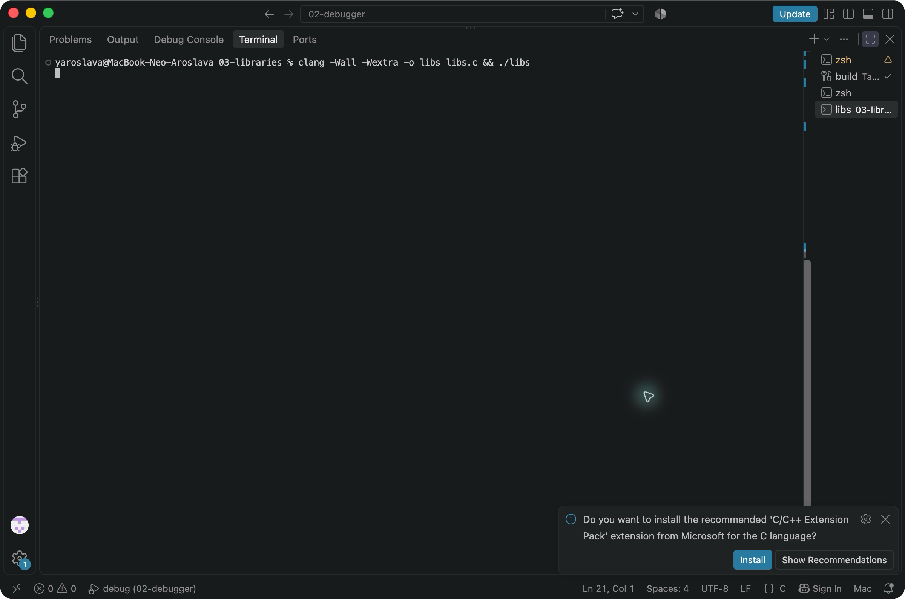
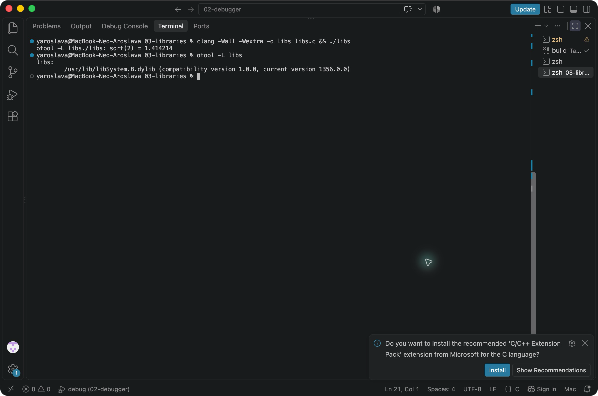
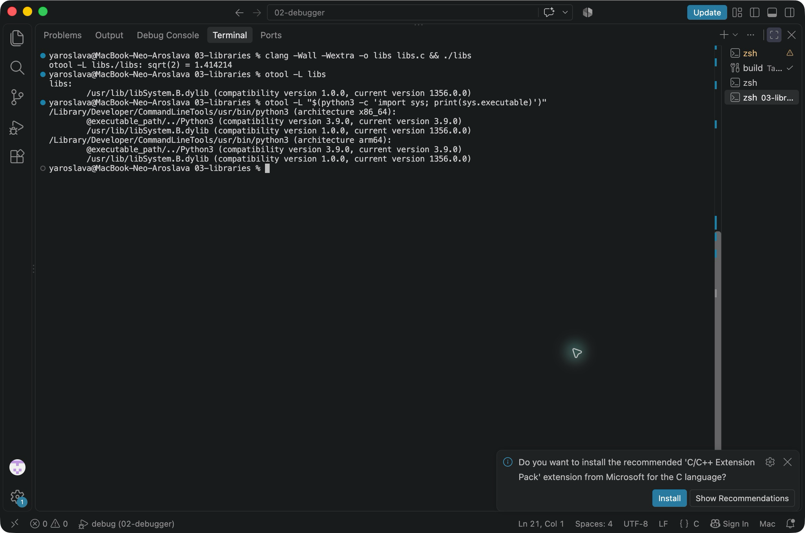
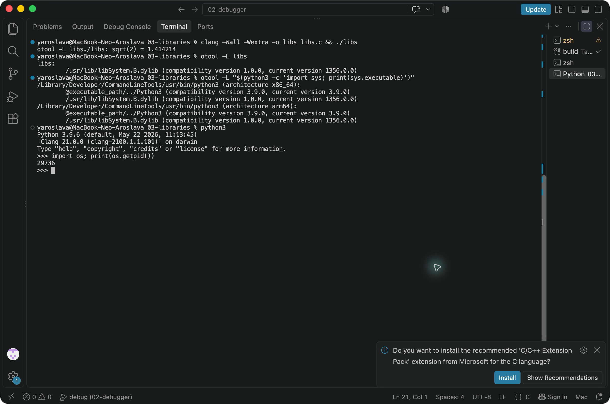
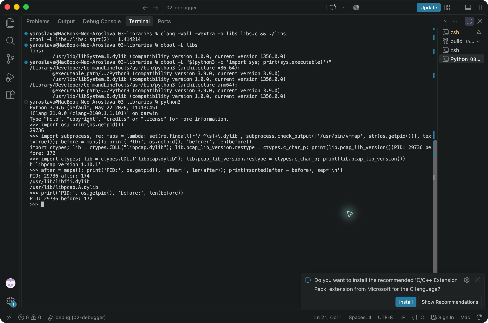
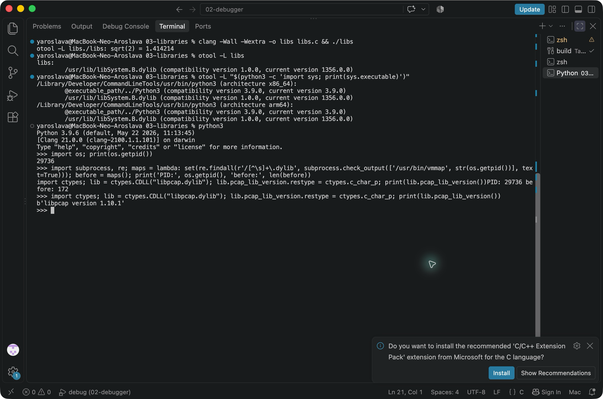
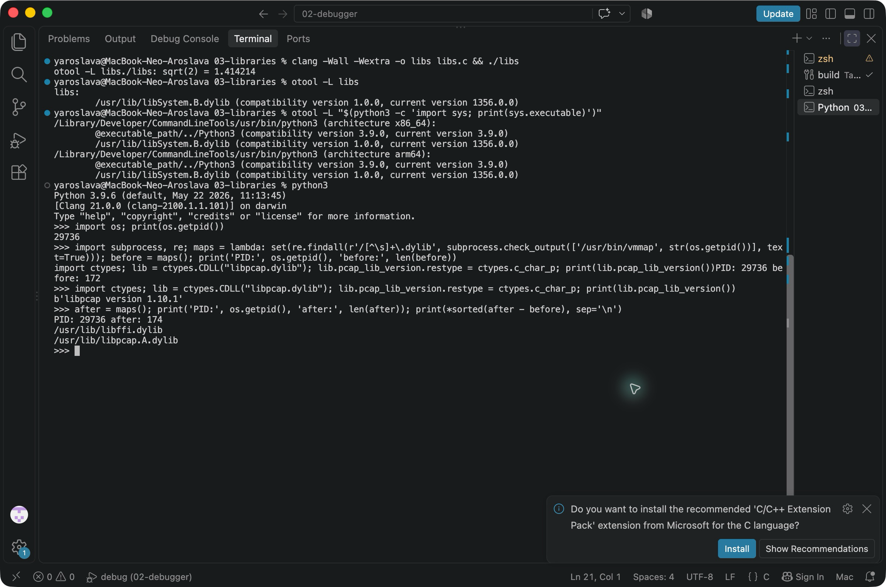

# ЛР 3. Библиотеки программы

1. После сборки программа вывела `./libs: sqrt(2) = 1.414214`.
2. `otool -L libs` показала одну зависимость, `/usr/lib/libSystem.B.dylib`. Математические функции входят в `libSystem`.
3. Интерпретатор находится в библиотеке `@executable_path/../Python3`, с которой связан запускатель Python.
4. PID процесса Python: 29736.
5. До загрузки `vmmap` показала 172 уникальных пути к файлам `.dylib`.
6. `ctypes.CDLL` загрузила `libpcap.dylib`. Функция вернула `libpcap version 1.10.1`.
7. После загрузки в том же процессе стало 174 библиотеки. Добавились `/usr/lib/libffi.dylib` и `/usr/lib/libpcap.A.dylib`.

[Открыть PDF](Лабораторная%20работа%203.pdf)

## Снимки

